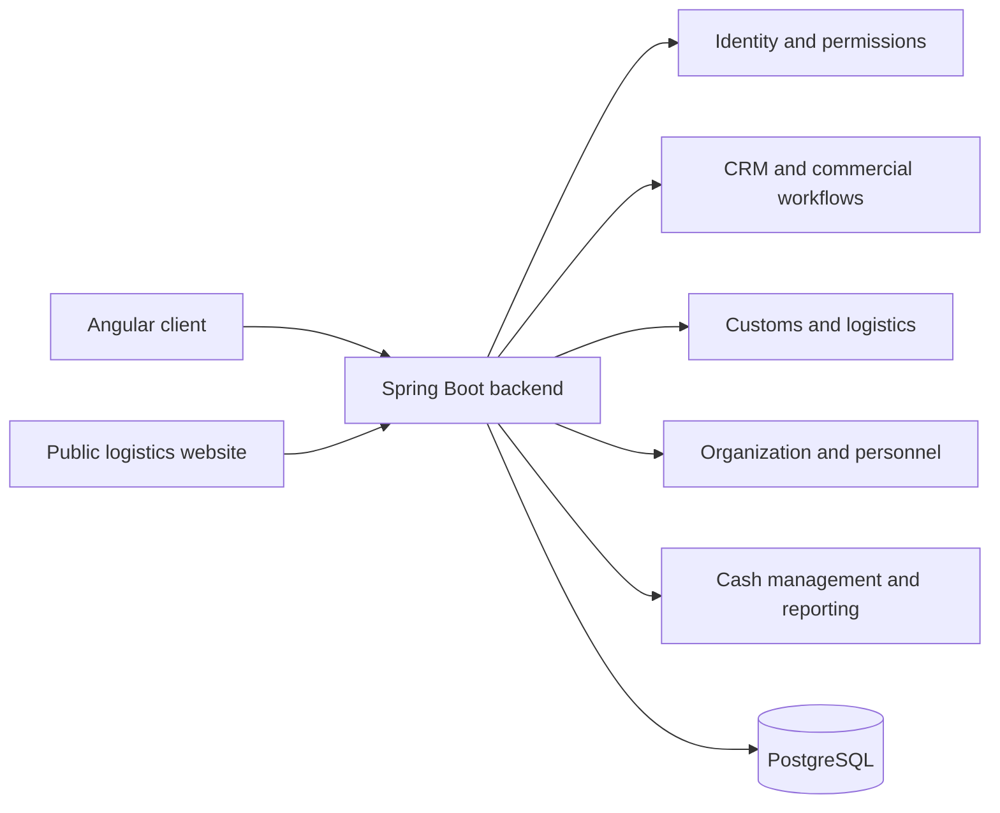

# ERP Douane Transit

**A business application connecting commercial requests, customs operations and internal management.**

| Item | Detail |
| --- | --- |
| My roles | Scrum Master, software architect and full-stack developer |
| Team | 4 people |
| First repository commit | 12 September 2026 |
| Latest reviewed commit | 7 October 2026 |
| Stack | Java 25, Spring Boot 4.1.1, Angular 21, PostgreSQL, Flyway, Docker |
| Public preview | [ERP Douane Transit](https://erp.mybestsejour.com/) |

These dates describe repository history, rather than employment or contract dates.

## Business problem

Transit and customs work involves commercial requests, assignments, supporting documents, financial operations and operational follow-up. The product brings these workflows into an application with shared identity and reporting.

The backend includes domains for CRM, customs, logistics, organization, personnel operations, cash management and dashboards.

## My contribution within the team

I combined software architecture, hands-on backend and frontend development, and Scrum Master responsibilities. The project is a team delivery; the architecture and test examples below describe the shared implementation.

## Architecture

The backend is a modular Spring Boot application. Business domains separate application services, domain models, persistence and web contracts. The Angular client consumes its APIs.

This simplified view represents domain boundaries inside one backend, rather than separate deployed microservices.

A modular application can keep cross-domain workflows and deployment manageable while preserving explicit business boundaries. Further service extraction should be driven by actual operational needs.

## Concrete engineering evidence

- Business tests verify that a first payment converts a prospect and moves a commercial request into a dossier.
- Another test verifies that a later payment does not repeat customer conversion.
- Assignment tests cover multiple employees and notification of new assignees.
- Closing and reopening a request are covered with audit recording.
- The identity configuration includes password hashing and permission checks.
- The GitHub Actions deployment runs Maven tests before packaging, publishes an image tagged with the commit, and checks backend health.
- The deployment includes a database backup step; restoration and rollback exercises require separate validation.

The reviewed backend workflow reported success on the reviewed commit, including its **Test** step. This is recorded CI evidence, not a new test run performed for this portfolio.

## Public demonstration scope

The public URL shows the logistics website. Its contact form is connected to the commercial workflow in the source, but no form submission was performed during the review.

Internal CRM, customs, cash and personnel screens require authorized access. A recruiter demonstration should use synthetic records.

## Next engineering milestones

- Add an integration test spanning commercial request, dossier and customs operation.
- Add frontend tests for sensitive permissions and financial workflows.
- Document local startup and a reproducible dataset.
- Exercise restore and rollback procedures.
- Record a short demonstration with fictitious client and employee data.

## Interview discussion

I would use this project to discuss domain boundaries, transactional workflows, authorization, avoiding repeated business actions and the difference between a successful deployment and operational recovery.

[Back to the profile](../README.md)

