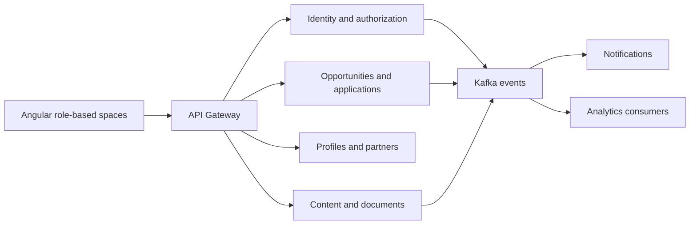

# YouthConnekt Cameroon

**A platform connecting young people with opportunities, applications and partners.**

| Item | Detail |
| --- | --- |
| My roles | Scrum Master, software architect and full-stack developer |
| Team | 4 people |
| First repository commit | 2 July 2026 |
| Latest reviewed commit | 29 September 2026 |
| Stack | Java 25, Spring Boot 4.0.7, Angular 21, PostgreSQL, Kafka, Redis, MinIO |
| Public platform | [YouthConnekt Cameroon](https://youthconnektcameroon.org/) |

These dates describe repository history, rather than the start of the wider YouthConnekt programme.

## Business problem

The product supports public opportunity discovery and account-based workflows for young people, partners and administrators. It includes applications, profile management, documents, notifications and content.

The public platform shows opportunities, events, partner information and links to candidate and partner spaces.

## My contribution within the team

I worked as Scrum Master, software architect and full-stack developer in a four-person team. The shared implementation includes backend services, frontend API integration, contribution rules and deployment workflows.

## Architecture

The backend repository contains 22 service directories, including infrastructure and business services. Its service count describes the repository structure, not a claim of scale or a count of independently verified production services.

The diagram groups services to make the main workflow readable.

The event matrix documents producers, consumers and integrations still to be completed. This distinction matters when reviewing a distributed architecture.

## Concrete engineering evidence

- Backend notification code checks event identifiers and channels before creating duplicate notifications.
- Frontend authentication tests distinguish partner administration from platform administration.
- Tests cover current authorization roles and permissions rather than relying only on potentially stale bootstrap roles.
- Application-service tests verify HTTP methods, routes and payloads for drafts, document attachment, submission and withdrawal.
- The reviewed frontend merge-request pipeline reported a successful test job.
- Contribution guidance describes feature branches, a development environment, peer review and manual production deployment.

The reviewed production frontend pipeline reported success. Backend packaging in the inspected pipeline skips Maven tests; sampled backend Java tests are context-loading tests. These are different levels of evidence.

## Public demonstration scope

The public homepage was accessible during the review. Opportunity discovery can be demonstrated without exposing applicant records. Account-based workflows should use a dedicated demonstration account and synthetic documents.

No applicant counts, completion percentages or performance gains are claimed.

## Next engineering milestones

- Add backend tests for application transitions and denied access.
- Test duplicate event delivery and concurrent processing, including database constraints.
- Make backend tests a delivery gate.
- Refresh the use-case matrix so implemented, partial and planned workflows remain consistent.
- Measure operational outcomes before adding impact figures.

## Interview discussion

I would discuss service boundaries, the cost of distributed systems, event handling, idempotency, current permissions and collaboration across backend and frontend work.

[Back to the profile](../README.md)

